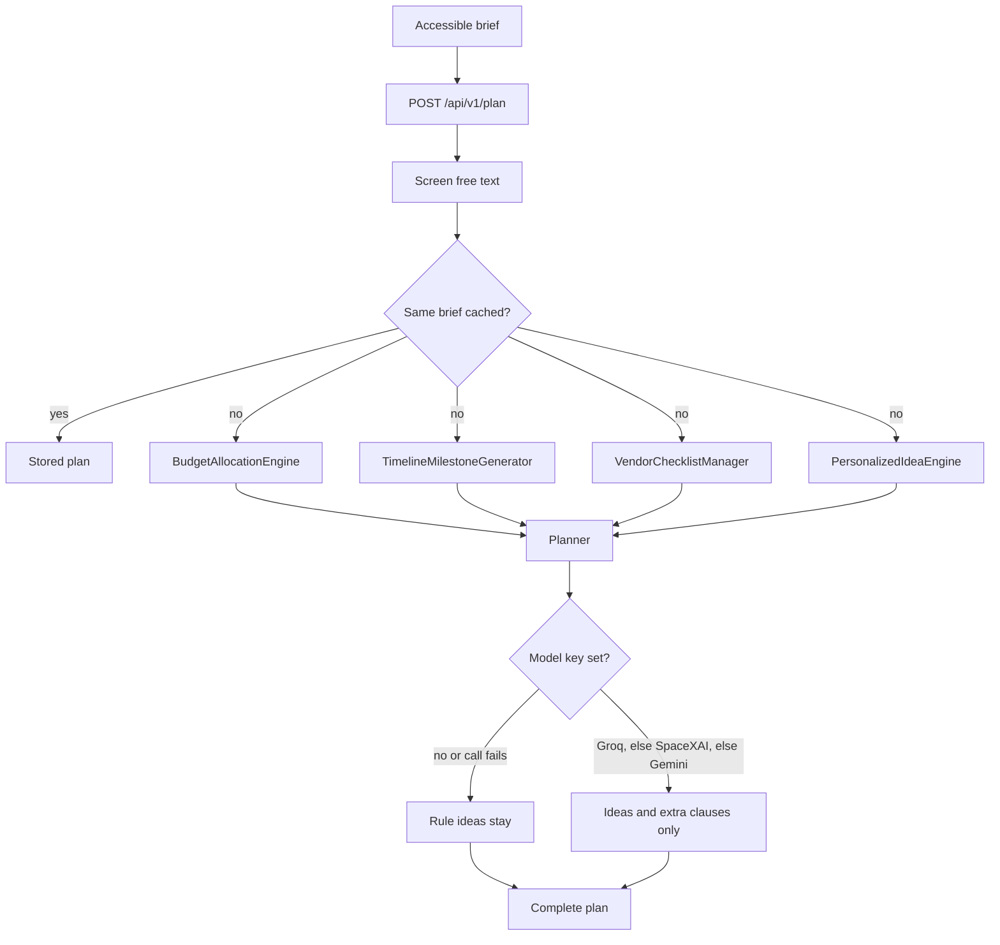

# EventCraft AI

EventCraft is a celebration planner for the three briefs in this challenge: **weddings**, **birthdays**, and **community events**. The flagship persona is the wedding architect. The same four engines serve the other two verticals with different rules.

A plan always has four parts:

1. A budget that adds up to the rupee, with an emergency buffer held back.
2. A timeline built backward from the event date, including an emergency sprint when fewer than 14 days remain.
3. A vendor and permit checklist with lead times, deposits, and the contract clauses that usually cause disputes.
4. A short list of ideas that use the city, the guest count, the diet, and the culture notes.

Money and dates are calculated in Python. A model, when one is configured, may only write ideas and extra contract sentences. If no key is set, or the model call fails, the rule library still returns a complete plan.

## Chosen verticals

| Vertical | Persona | What the rules protect |
| --- | --- | --- |
| Wedding (flagship) | Wedding architect | Venue and catering at 45%, a 10% buffer, hospitality lifted for a destination, multi-ritual milestones |
| Birthday | Birthday curator | One experience, a real cake contract, age-band shifts, a four-week sprint |
| Community event | Community event director | Permits and NOC before posters, water and safety before programming, a larger 14% reserve |

The problem statement asks for budgets, timelines, vendor checklists, and personalized ideas. Each of those is a named engine, not a single prompt.

## How it works



1. The form sends a strict JSON brief. Pydantic rejects out-of-range budgets, guest counts, dates, and unknown fields.
2. Free text is screened for prompt injection, script tags, and a few SQL-shaped strings. Benign markup is stripped.
3. **BudgetAllocationEngine** starts from the persona's baseline weights, applies location, setting, and age shifts, then moves flexible lines with the priority sliders. The buffer is not on a slider. Amounts are integers and sum to the budget.
4. **TimelineMilestoneGenerator** counts the days remaining. Under 14 days it uses a 48-hour emergency sprint. Under 90 days it compresses the phase list and pulls missed critical tasks forward. Longer runways keep the full phase plan.
5. **VendorChecklistManager** turns persona vendors into book-by dates. Optional rows such as mehendi appear only when the brief mentions them. A missed lead time is labeled as such.
6. **PersonalizedIdeaEngine** scores the idea library against the brief. The city and guest count are written into the copy.
7. **LlmOrchestrator** is optional. Provider order is Groq (`openai/gpt-oss-120b`), then SpaceXAI on the xAI API (`grok-4.7`), then Gemini, all through one OpenAI-compatible HTTP client. The model receives the numbers as facts and a schema that has no money fields. User notes are wrapped as untrusted data.
8. Identical briefs are stored in a SHA-256 LRU cache with a TTL, so a repeat does not call a model again.
9. `POST /api/v1/rebalance-budget` refits one category. Critical lines keep more of what remains. The buffer cannot fall through its floor.

## Approach and logic

The planner is hybrid on purpose. An LLM is good at wording a courtyard ceremony. It is bad at making six percentages sum to 100, and a hackathon grader that changes the guest count should still see a coherent plate cost.

Context changes the numbers:

- A destination wedding moves weight from decor into rooms and transfers.
- An outdoor ceremony moves weight into cover, power, and water.
- A children's party funds the activity and the cake. A 50th funds seating and the meal.
- A metro community event and an outdoor one both move weight from outreach into safety.
- A plate cost under the tier's floor produces a warning instead of a fake "luxury" menu.
- A community date inside three weeks warns that permission may no longer be possible.

What-if rebalancing is the other decision. Raising decor does not mint new money. Something else shrinks, non-critical lines first, and the buffer stays.

## Evaluation criteria alignment

| Criterion | Where to look |
| --- | --- |
| Code quality | `src/domain/`, `src/services/`, `src/api/`, `src/core/`. Pydantic v2 models, type annotations, Google-style docstrings, one responsibility per module. Wedding, birthday, and community rules are separate modules. Rupees are split with the largest-remainder method, O(C log C) in the category count, and category lookup is one dictionary read. Planning thresholds live in `src/domain/bounds.py`. `pyproject.toml` holds the Ruff, mypy, and pytest config. `ruff check .` and `mypy main.py src tests` are clean. |
| Problem statement alignment | `BudgetAllocationEngine` in `src/services/budget_engine.py`, `TimelineMilestoneGenerator` in `src/services/timeline_engine.py`, `VendorChecklistManager` in `src/services/checklist_engine.py`, `PersonalizedIdeaEngine` in `src/services/idea_engine.py`. Persona rules live in `src/domain/wedding_persona.py`, `birthday_persona.py`, and `community_persona.py`. |
| Security | `src/core/security.py`: injection screen after NFKC normalization and invisible-character stripping, tag stripping, token-bucket rate limit on `/api/` (the connection address is used, `X-Forwarded-For` is ignored), body-size cap, and response headers including CSP without `unsafe-inline`, COOP, CORP, and HSTS. Keys are read only from the environment. |
| Efficiency | Deterministic math for money and dates. `src/core/cache.py` is a content-addressed LRU with TTL. Responses over 500 bytes are gzipped. Model calls are async, capped at 2,500 output tokens, and skipped entirely when no key is set. |
| Testing | `tests/test_problem_statement.py`, `tests/test_alignment.py`, `tests/test_security.py`, `tests/test_api.py`, `tests/test_efficiency.py`, `tests/test_accessibility.py`, `tests/test_edges.py`. The suite runs offline. A mocked model failure and a Groq fallback are covered. `.github/workflows/check.yml` runs Ruff, mypy, and pytest. |
| Accessibility | `src/web/templates/index.html`, `src/web/static/css/styles.css`, `src/web/static/js/app.js`. Skip link, landmarks, labeled controls, radiogroup and tab keyboard patterns, native checkboxes, `aria-live` status, priority sliders expose `aria-valuetext`, plan errors are focused, meter values have text, and ink-on-paper contrast is above 7:1. Plan text is inserted with `textContent`. |

## Run it

```bash
python3.12 -m venv .venv
source .venv/bin/activate
pip install -r requirements.txt
cp .env.example .env   # optional; leave keys blank to use the rule library
uvicorn main:app --host 127.0.0.1 --port 8000
```

Open http://127.0.0.1:8000 . The wedding sample is loaded. Generate plan, then try the other samples, including the ten-day wedding, which switches the timeline into an emergency sprint. The budget tab can rebalance one category without calling a model.

Interactive API docs: http://127.0.0.1:8000/docs

```bash
pytest
```

### API

`POST /api/v1/plan`

```json
{
  "event_type": "wedding",
  "event_name": "Meera and Arjun",
  "total_budget": 1800000,
  "guest_count": 250,
  "event_date": "2027-06-18",
  "location_tier": "destination",
  "city": "Jaipur",
  "setting": "outdoor",
  "cultural_preferences": "Hindu pheras and a short mehendi",
  "dietary_notes": "Vegetarian, with a Jain line",
  "priorities": {"venue_catering": 5, "decor": 2}
}
```

`POST /api/v1/rebalance-budget` takes the current `allocations`, a `changed_category`, and a `new_amount`.

`GET /health` reports whether a model provider is configured and the cache counters.

`GET /api/v1/personas` is what the form uses to draw priority sliders.

### Model keys

Set at most the keys you have. The first one in this list is used; the next is tried if that call fails.

| Variable | Provider | Default model |
| --- | --- | --- |
| `GROQ_API_KEY` | Groq | `openai/gpt-oss-120b` |
| `XAI_API_KEY` | SpaceXAI, via `https://api.x.ai/v1` | `grok-4.7` |
| `GEMINI_API_KEY` | Gemini OpenAI-compatible endpoint | `gemini-2.5-flash` |

Do not commit `.env`. The sample file is `.env.example`.

## Assumptions

- Currency is INR. The challenge audience and the date window are Indian, and the per-guest floors are planning heuristics for metro, tier-2, and destination events. They are not quotes.
- The event date is the main day. Mehendi, sangeet, rehearsals, and volunteer briefings are milestones, not separate budgets.
- One plan is one session. Nothing is written to a database. Checklist ticks stay in the browser's `localStorage`.
- Deposit percentages are typical ranges a planner argues about. They are not legal advice.
- Guest count for a community event means the footfall you will enforce, not an aspirational crowd.
- Priority scores only exist for categories the persona publishes. Unknown scores are ignored. Scores run from 1 to 5.
- The app binds to `127.0.0.1` by default.

## Repository notes

Keep this repository on a single branch and under 10 MB. `.venv`, caches, and `.env` are gitignored. Static files are CSS, one script, and a small SVG icon.
